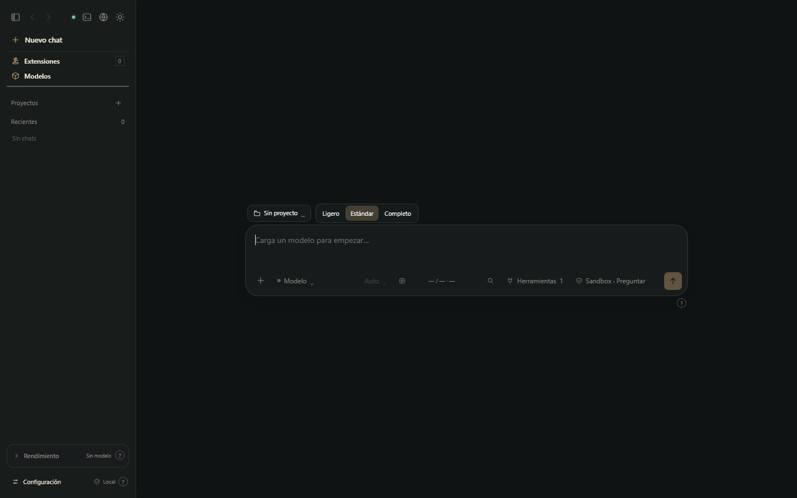
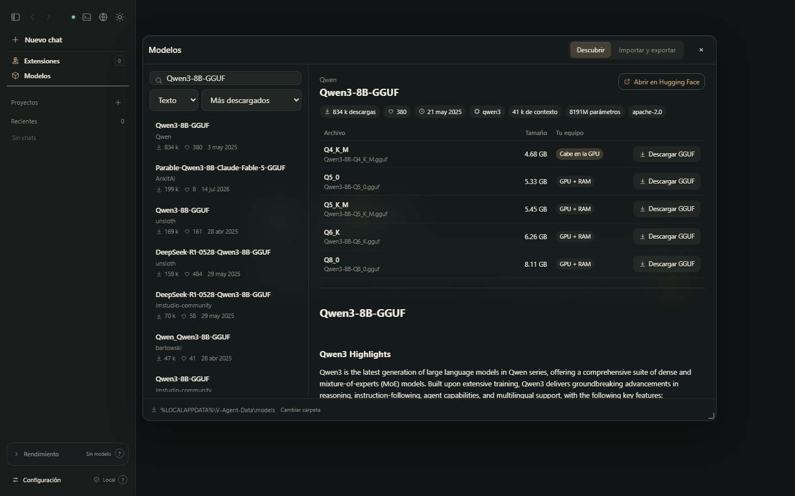

# V-Agent

**Un agente de IA local para Windows.**
Ejecuta modelos GGUF en tu propio PC con cuatro motores locales (o con tus propias compilaciones) —o conecta
una API compatible con OpenAI, Claude, Azure u OpenRouter— con búsqueda y lectura web integrada con
DuckDuckGo (`WebSearch`/`WebVisit`), lectura de documentos, navegador autónomo y permisos claros por acción.

  

[Descargar](../../releases/latest) · [Arquitectura](docs/ARCHITECTURE.md) · [Calidad](docs/QUALITY.md) · [Cambios](CHANGELOG.md) · [Read in English](README.md)

> [!IMPORTANT]
> **Desarrollado y probado de forma independiente, financiado al 100 % de mi bolsillo.**
>
> V-Agent no tiene anuncios, cuentas ni telemetría. Si te ayuda en tu día a día, considera
> [apoyarlo en Ko-fi](https://ko-fi.com/isvalorum). Cada aporte se destina al hardware y al tiempo de
> cómputo con que se prueban nuevos modelos, motores y versiones, y ayuda a sostener mis estudios
> universitarios.

## Motores locales, compilaciones propias y APIs remotas

V-Agent no se limita a apuntar a un servidor externo: **Strata, Strata Rust, llama.cpp y Project Maya** se
integran de forma nativa con su gestor de procesos privados, recomendador de hardware, estimador de memoria
y selector de modelos. Además, en los cuatro motores puedes seleccionar **tu propia compilación precompilada**
sin que se te obligue a descargar ni compilar nada.

| Motor | Qué hace V-Agent con él |
|---|---|
| **Strata · PolyStrata** (por defecto) | Servidor integrado y hub MCP para modelos **Mixture-of-Experts** y densos. Reajusta dinámicamente en cada turno la caché de expertos en VRAM, admite decodificación especulativa MTP, `strata-vision`, cachés KV (`fp16`/`q8_0`/`int8`/`int8k`) y selección de binario personalizado. |
| **Strata Rust** | Backend GPU para **Qwen3.5/3.6** con clave privada por sesión (`STRATA_API_KEY`), caché KV `f16`/`q8`/`q4`, métricas medidas y soporte de ejecutable propio. |
| **llama.cpp** | Compilaciones oficiales **CUDA 12.4**, **Vulkan** (AMD, Intel Arc, NVIDIA) o **CPU** elegidas según tu equipo desde GitHub (o tu propio `llama-server.exe`). Incluye ajuste automático `--fit`, cachés KV cuantizadas (`fp16`/`bf16`/`q8_0`/`q4_0`), modelos draft especulativos, visión (`mmproj`) y reintentos ante bloqueos de archivos al actualizar en Windows. |
| **Project Maya** *(opcional)* | Integración opcional para `mw00/project-maya` (**GLM-5.3-Flash**, **GLM-5.3 744B**, **DeepSeek-V4.1-Flash-1017**, **MiniMax-M3.1-Flash**, **Qwen-3.8-Flash-Next**) con diagnóstico de requisitos CUDA 13.2+ / VS 2026 y AMD ROCm, actualización por tags de GitHub, ajustes por familia y selector directo de carpeta o binario ya compilado. Nunca es obligatorio en el tutorial ni en ajustes. |
| **APIs remotas** | Conexión con **OpenAI compatible**, **Anthropic Claude** (`/messages`), **Azure OpenAI** (con respaldo clásico `/openai/deployments/`), **OpenRouter** y **OpenCode**, con modos de autenticación por conexión (`Bearer`, `x-api-key`, `api-key`, ninguno), `User-Agent`, `anthropic-beta`, UUID persistente `x-opencode-session`, cabeceras anti-buffer SSE y cabeceras personalizadas. |

Además, en los motores locales:
- **Opciones de carga por modelo (`agent/engine_options.py`):** lee `--help` del binario activo para mostrar únicamente los flags que admite esa compilación (Flash Attention, hilos de CPU, `mmap`/`mlock`/`load-mode`, KV offload, context shift, etc.), valida conflictos (como exigir Flash Attention para KV cuantizada) y guarda los ajustes por modelo.
- **Sin descargas ni compilaciones forzadas:** puedes instalar, restaurar a la versión anterior o **eliminar** motores administrados desde *Ajustes → Sistema → Actualizaciones de motores*, o elegir tu binario propio en *Modelo → Motor*.
- **Estimador de VRAM/RAM y métricas en vivo:** calcula pesos, caché KV, drafts y VRAM recuperable dentro de *Desglose de memoria*, y mide velocidades reales de prefill y decodificación (`tok/s`).

## Búsqueda y lectura web con DuckDuckGo (`WebSearch`/`WebVisit`) y 7 servidores MCP

V-Agent incluye siete servidores MCP coordinados por conversación y controlados por permisos reales en el núcleo:

| Servidor | Capacidades principales |
|---|---|
| **`duckduckgo` (`WebSearch` / `WebVisit`)** | Búsqueda web y lectura de páginas públicas (`web_search`, `web_visit`) integradas de serie, con botón de activación rápida en la barra de mensajes. Permite configurar en **Opciones MCP**: **región**, **idioma**, **SafeSearch**, **límite temporal** (`d`/`w`/`m`/`y`), **número de resultados**, filtrado de anuncios, timeout y presupuesto `visit_tokens` / `max_result_chars` desde `0` (**sin límite**) hasta `1.000.000`. Reintenta automáticamente sin comillas y con región global `wt-wt` si no hay resultados, extrae Markdown limpio con tablas y enlaces usando `trafilatura`, enfoca secciones con `find_in_page`, pagina instantáneas inmutables (`8 MiB` en páginas web), resume perfiles públicos de Hugging Face y **extrae documentos remotos PDF, DOCX, XLSX, PPTX, ODT, ODS, ODP, EPUB y RTF de hasta 24 MiB**. |
| **`pc` (Archivos, Documentos y Consola)** | Lectura, escritura y edición con números de línea, recibos en diff unificado, historial y deshacer (`file_history`), mapa de proyecto (`project_map`), recuperación de borradores largos (`draft_resume`), ejecución aislada (`wxc-exec.exe`) o en todo el PC con **Consola** compartida, y **`pc__doc_read`** para leer en local **PDF** (con respaldo OCR de Windows para páginas escaneadas), Word, Excel, PowerPoint, OpenDocument, EPUB, RTF, CSV, HTML y XML. |
| **`autobrowser` (Navegador autónomo)** | Navegador CDP sin ventana (`open`, `navigate`, `snapshot`, `text`, `click`, `fill`, `press`, `evaluate`, `screenshot`, `cookies`, `network`, `browser_console`) capaz de capturar Shadow DOM e iframes anidados, conectado con el panel visual **Navegador** integrado (con pantalla completa). |
| **`web` (HTTP y descargas)** | Herramientas `http_request` y `download` (hasta `512 MiB`) con validación de redirecciones y bloqueo de redes privadas por defecto. |
| **`computer` (Control de escritorio)** | Captura de pantalla, OCR (`ocr_image`), lista y foco de ventanas, ratón y teclado (solo con permiso explícito de acceso total). |
| **`admin` (Consola elevada opcional)** | Helper UAC opcional por sesión sobre pipe privado para comandos administrativos puntuales en PowerShell o CMD. |
| **`hf` (Hugging Face)** | Consulta la cuenta HF configurada y descarga o gestiona archivos junto con el buscador gráfico en *Modelos*. |

También incluye soporte de **Extensiones, Plugins y servidores MCP externos**, con límites ajustables en *Tools → Opciones MCP*.

## Interfaz, modelos y productividad

- **Ventana Modelos e importación local:** explora Hugging Face (descargas, likes, contexto, licencia, ficha renderizada y si cada cuantización cabe en tu GPU/RAM), descarga verificando SHA-256 e importa o exporta modelos y ajustes con **LM Studio** y **Unsloth Studio** (sin copiar ni alterar tus `.gguf`).
- **Proyectos y carpetas aisladas por chat:** cada conversación tiene su propia carpeta aislada, o puedes trabajar dentro de una carpeta de **Proyecto** tuya; tres perfiles de autonomía (**Ligero**, **Equilibrado** y **Completo**) con aprobaciones aplicadas por el núcleo.
- **Traza de herramientas compacta y compactación de contexto:** las llamadas a herramientas se agrupan en un bloque colapsable con contador de pasos y errores. Las conversaciones largas pueden comprimirse con **Compactar contexto** (resumen local, OpenAI `/responses/compact` o Anthropic `/messages`).
- **Verificación automática de código:** valida sintaxis y compilación en Python, JavaScript, CSS, PowerShell, JSON, YAML, TOML, XML/SVG y Java (además de TypeScript, C/C++, Rust, Go, PHP, Ruby y Lua si están instalados), y abre páginas HTML en navegador aislado para reportar errores de consola con línea.
- **5 idiomas y personalización visual:** interfaz traducida por completo a **Español, English, Português, Français y Deutsch** (`1.899` frases), estilos **Glass** / **Deco**, modos Día / Noche / **AMOLED**, paletas de color y recorrido guiado inicial opcional.

## Calidad y pruebas

- **338 pruebas unitarias automáticas en Python** + **8 suites JS (`.cjs`)** que cubren cambio de motores, compilaciones propias en los 4 motores locales, opciones de carga por modelo, protocolos de API remota, firmas y actualizaciones, seguridad, aislamiento de procesos (`wxc-exec.exe`), recuperación MCP y las 5 traducciones.
- **Sondas y pruebas con modelos reales (`tests/smoke/`, `scripts/quality/`):** pruebas de extremo a extremo con `llama.cpp`, `Strata`, `Strata Rust` y matriz de `Project Maya`, arranque aislado, auditoría de diseño sin parpadeos y capturas completas de interfaz.
- **Compilación limpia verificada (`scripts/clean_release_build.py`):** genera el instalador desde un *worktree* limpio de Git y comprueba que `strata-core.exe`, `V-Agent.exe` y `agent/ui/dist` estén libres de datos personales, rutas de usuario, seeds, modelos, llaves privadas o perfiles de navegador.

Consulta [docs/QUALITY.md](docs/QUALITY.md), [CHANGELOG.md](CHANGELOG.md) y [docs/test-reports/1.0.7.md](docs/test-reports/1.0.7.md).

## Instalar

1. Descarga `V-Agent_<versión>_x64-setup.exe` desde [Releases](../../releases/latest) (Windows 10/11, x64).
2. Ábrelo (empaquetado con compresión rápida `zlib`, sin permisos de administrador). Windows puede mostrar **"Windows protegió tu PC"**: revisa la nota inferior.
3. Elige idioma (*Español, English, Português, Français, Deutsch*) y carpeta de instalación.
4. Al iniciarlo por primera vez, el recorrido opcional te deja elegir motor, apuntar a tu propia compilación o conectar una API remota sin forzar descargas.

> [!IMPORTANT]
> **Sobre el aviso "Windows protegió tu PC".** El instalador aún no usa un certificado comercial de
> firma de código Microsoft Authenticode, por lo que Windows SmartScreen muestra este aviso con descargas
> nuevas. Pulsa **Más información → Ejecutar de todas formas** únicamente si lo descargaste de los
> [Releases](../../releases/latest) de este repositorio.
>
> Puedes verificar tu descarga en PowerShell:
> `Get-FileHash .\V-Agent_<versión>_x64-setup.exe`
> y comparar el resultado con el valor `sha256` del archivo `v-agent-update.json` de esa misma versión
> (V-Agent valida además su firma Ed25519 automáticamente antes de aplicar actualizaciones).

V-Agent se mantiene al día: tras abrirse aplica las **actualizaciones menores** firmadas (*1.1.1 C1, C2…*,
sin reinstalar) y descarga instaladores nuevos en segundo plano. Al pulsar **Instalar y reiniciar**, muestra
un mini menú de progreso traducido al idioma elegido mientras instala y relanza V-Agent automáticamente.

## Mapa del repositorio

| Carpeta | Qué contiene |
|---|---|
| [`agent/`](agent/) | Núcleo, bucle del agente, motores locales/remotos (`engine_manager.py`, `maya_engine.py`, `engine_options.py`), servidores MCP, actualizaciones e interfaz en [`agent/ui/`](agent/ui/). |
| [`serve/`](serve/) | Capa de peticiones compatible con OpenAI/Anthropic y hub MCP (basado en PolyStrata). |
| [`web_mcp/`](web_mcp/) | Búsqueda y lectura web integrada con DuckDuckGo (`buscador_mcp.py`, `busqueda_local.py`) y herramientas HTTP (`http_tools_mcp.py`). |
| [`tools/`](tools/) | Lector de metadatos GGUF y tokenizador para importación de modelos. |
| [`desktop/`](desktop/) | Aplicación de escritorio Windows (Tauri 2, Rust) y configuración NSIS `zlib`. |
| [`scripts/`](scripts/) | Ensamblador UI (`build-ui.py`), compilador limpio (`clean_release_build.py`) y firma Ed25519 (`release.py`). |
| [`tests/`](tests/) | Pruebas unitarias Python, suites JS `.cjs` y pruebas con modelo real. |
| [`docs/`](docs/) | Arquitectura, API local, guía de usuario e informes de calidad. |

## Compilar y probar

Requisitos: Windows 10/11 x64, Python 3.13, Node.js 20+, Rust (MSVC estable) y Visual Studio Build Tools.
Los comandos completos están en el [README en inglés](README.md#build-and-test) y en [CONTRIBUTING.md](CONTRIBUTING.md).

## Seguridad y privacidad

- Todo escucha únicamente en `127.0.0.1` validando orígenes locales; los servidores de motores exigen una clave privada por sesión.
- Los archivos `.gguf` nunca se copian ni se modifican.
- Los comandos se ejecutan en sandbox de procesos de Windows (`wxc-exec.exe`) en modo aislado o de proyecto; el acceso total al PC es opcional.
- Las aprobaciones de escritura, comandos y red se aplican en el núcleo Python, no solo en la interfaz.
- Instaladores y componentes menores se verifican con firma Ed25519 del autor; motores y descargas de Hugging Face se verifican por origen y SHA-256.

Lee [SECURITY.md](SECURITY.md) y [PRIVACY.md](PRIVACY.md) para más detalles.

## Licencia

[Apache License 2.0](LICENSE). Los componentes incluidos conservan sus licencias: ver [NOTICE](NOTICE),
[LICENSE.Strata](LICENSE.Strata) y [THIRD-PARTY-NOTICES.md](THIRD-PARTY-NOTICES.md).
