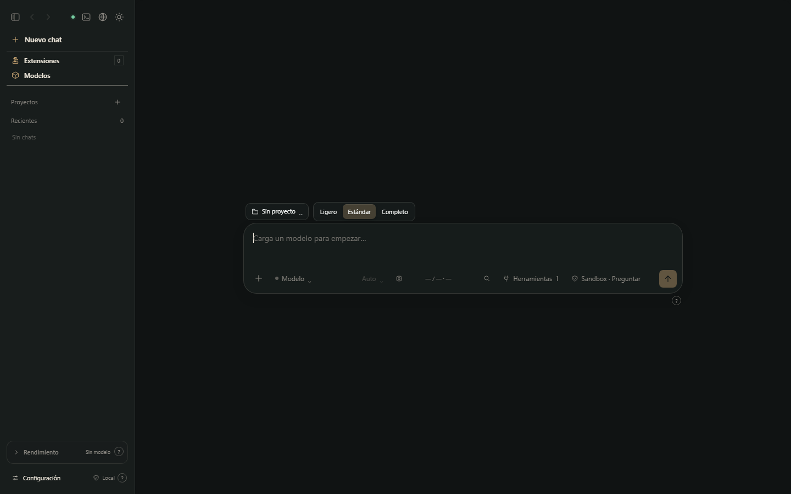
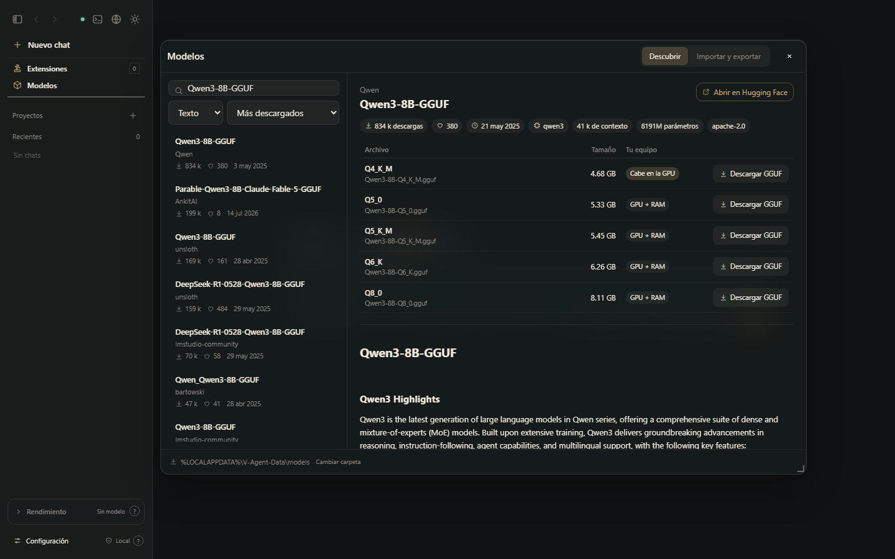

# V-Agent

**Un agente de IA local para Windows.**
Ejecuta modelos GGUF en tu propio PC —o conecta una API compatible con OpenAI o Claude— y dales
herramientas reales con permisos claros.

  

[Descargar](../../releases/latest) · [Arquitectura](docs/ARCHITECTURE.md) · [Cambios](CHANGELOG.md) · [Read in English](README.md)

## Qué hace

- **Ejecuta modelos en tu equipo** con las compilaciones oficiales de **llama.cpp** (CUDA, Vulkan o CPU,
  según tu hardware, descargadas de sus releases de GitHub), **Strata** o **Strata Rust**. También
  funciona con APIs remotas compatibles con OpenAI y Claude.
- **Le da herramientas al modelo**: archivos (con versiones y deshacer), comandos, búsqueda web y
  lectura de páginas, un navegador autónomo, peticiones HTTP, Hugging Face y cualquier servidor MCP,
  dentro de una **carpeta aislada por chat** o en todo el PC, con aprobación por acción.
- **Te ayuda a encontrar modelos**: la ventana *Modelos* explora Hugging Face (descargas, likes,
  contexto, licencia, la ficha renderizada y si cada cuantización cabe en tu GPU), descarga verificando
  el SHA-256 e importa modelos y sus ajustes desde **LM Studio** y **Unsloth Studio**.
- **Revisa el código que escribe**: sintaxis de Python, JavaScript, JSON, YAML, TOML, XML/SVG y Java; las
  páginas HTML se ejecutan en un navegador sin interfaz y reportan los errores.
- **Sigue siendo tuyo**: sin cuenta y sin telemetría. Las actualizaciones van firmadas y la app solo
  acepta lo que firma el autor.

## Instalar

1. Descarga `V-Agent_<versión>_x64-setup.exe` desde [Releases](../../releases/latest) (Windows 10/11, x64).
2. Elige idioma (Español, English, Português, Français, Deutsch) y carpeta. No hace falta ser administrador.
3. Al abrirlo por primera vez te recomienda un motor para tu hardware y lo instala cuando confirmas.
4. Añade un modelo GGUF o abre **Modelos** para buscar uno, y empieza a chatear. Un tutorial breve explica el resto.

V-Agent se mantiene al día solo: al poco de abrirse aplica la **actualización menor** firmada más
reciente (numeradas *1.0.0 C1, C2…*, sin instalador) y descarga un instalador más nuevo si existe, que
solo instala cuando tú lo indicas.

## Mapa del repositorio

| Carpeta | Qué contiene |
|---|---|
| [`agent/`](agent/) | El núcleo: bucle del agente, API local, motores, herramientas (servidores MCP), actualizaciones y la interfaz (`index.html` + `ui-*.js`). |
| [`serve/`](serve/) | Capa de peticiones compatible con OpenAI/Anthropic y el hub MCP, tomados de PolyStrata. |
| [`web_mcp/`](web_mcp/) | Búsqueda web, lectura de páginas y herramientas HTTP (servidores MCP). |
| [`tools/`](tools/) | Lector de cabeceras GGUF y tokenizador usados al importar modelos. |
| [`desktop/`](desktop/) | La aplicación de Windows (Tauri 2, Rust) y la configuración del instalador. |
| [`scripts/`](scripts/) | Compilación, empaquetado, sincronización de la interfaz y firma de versiones. |
| [`tests/`](tests/) | Pruebas automáticas (Python + interfaz) y pruebas manuales con modelo real. |
| [`docs/`](docs/) | Arquitectura, API local, guía de usuario, capturas y notas de diseño. |

## Compilar y probar

Requisitos: Windows 10/11 x64, Python 3.13, Node.js 20+, Rust (stable, MSVC) y Visual Studio Build Tools.
Los comandos están en el [README en inglés](README.md#build-and-test) y en [CONTRIBUTING.md](CONTRIBUTING.md).

## Licencia

[Apache License 2.0](LICENSE). Los componentes incluidos conservan sus licencias: ver [NOTICE](NOTICE),
[LICENSE.Strata](LICENSE.Strata) y [THIRD-PARTY-NOTICES.md](THIRD-PARTY-NOTICES.md).
