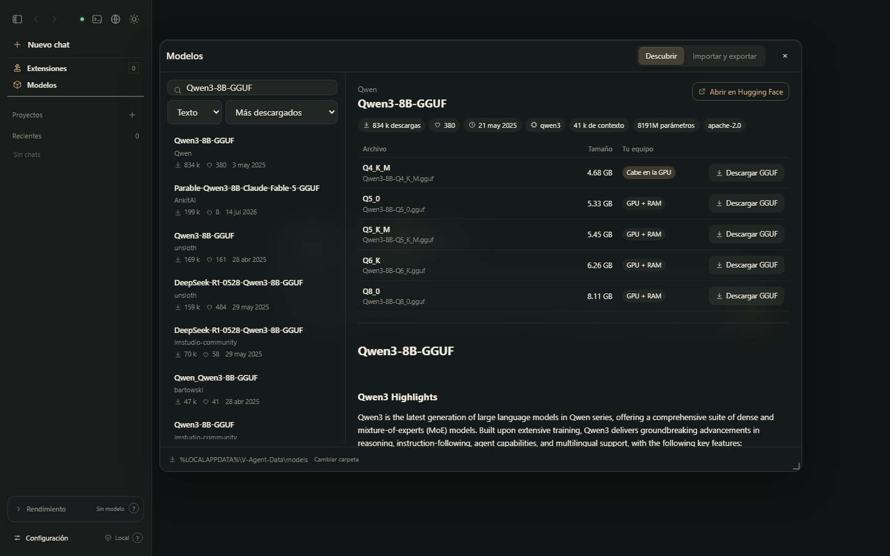

<div align="center">

# V-Agent

**A local-first AI agent for Windows.**
Run GGUF models on your own PC across four local engines (or bring your own custom builds) — or connect an
OpenAI / Claude / Azure / OpenRouter API — with integrated DuckDuckGo WebSearch/WebVisit, document
reading, autonomous browser tools, and clear per-action permissions.

[](https://github.com/IsValorum/V-Agent/actions/workflows/tests.yml) [](https://github.com/IsValorum/V-Agent/releases/latest) [](LICENSE)

[Download](../../releases/latest) · [Architecture](docs/ARCHITECTURE.md) · [Quality](docs/QUALITY.md) · [Changelog](CHANGELOG.md) · [Leer en español](README.es.md)


</div>

<a href="https://ko-fi.com/isvalorum"></a>

> [!IMPORTANT]
> **Built and tested independently, funded 100% out-of-pocket.**
>
> V-Agent has no ads, no accounts and no telemetry. If it helps you in your day-to-day work, consider
> [supporting it on Ko-fi](https://ko-fi.com/isvalorum). Every contribution goes into the hardware and
> compute time used to test new models, engines and releases, and helps support my university studies.

## Local engines, custom builds, and remote APIs

V-Agent doesn't just point at a server you manage yourself: **Strata, Strata Rust, llama.cpp, and Project Maya**
integrate directly with its private runtime, hardware recommender, memory estimator, and model switcher. Every local
engine can also use **your own pre-compiled build** without forcing downloads or local compilation.

| Engine | What V-Agent does with it |
|---|---|
| **Strata · PolyStrata** (default) | Bundled server and MCP hub for **Mixture-of-Experts** and dense GGUF models. Dynamically sizes the GPU expert cache before every turn, supports MTP speculative decoding, `strata-vision`, `fp16`/`q8_0`/`int8`/`int8k` KV cache formats, and lets you point directly to a custom `strata-poly.exe` build. |
| **Strata Rust** | GPU backend for **Qwen3.5/3.6** models started with a per-session private `STRATA_API_KEY`, `f16`/`q8`/`q4` KV cache, measured timings, and optional custom executable selection. |
| **llama.cpp** | Official **CUDA 12.4**, **Vulkan** (AMD, Intel Arc, NVIDIA), or **CPU** builds chosen for your hardware from GitHub releases (or your own custom `llama-server.exe`). Includes automatic `--fit` layer/context sizing, quantized KV formats (`fp16`/`bf16`/`q8_0`/`q4_0`), speculative draft models, `mmproj` vision, and clean Windows update lock retries. |
| **Project Maya** *(optional)* | Optional local integration for `mw00/project-maya` (**GLM-5.3-Flash**, **GLM-5.3 744B**, **DeepSeek-V4.1-Flash-1017**, **MiniMax-M3.1-Flash**, **Qwen-3.8-Flash-Next**) with Windows CUDA 13.2+ / VS 2026 & AMD ROCm prerequisite checks, GitHub tag auto-updates, per-family tuning UI, and direct folder/binary selection. Never forced in onboarding or settings. |
| **Remote APIs** | Connects to **OpenAI-compatible**, **Anthropic Claude** (`/messages`), **Azure OpenAI** (with `/openai/deployments/` fallback), **OpenRouter**, and **OpenCode** endpoints with per-connection auth modes (`Bearer`, `x-api-key`, `api-key`, none), `User-Agent`, `anthropic-beta`, persistent `x-opencode-session` UUIDs, SSE anti-buffering, `HTTP-Referer`/`X-Title`, and custom headers. |

Across local engines:
- **Per-model engine load options (`agent/engine_options.py`):** Dynamically inspects `--help` on the active executable so only supported flags are shown (Flash Attention, CPU threads, `mmap`/`mlock`/`load-mode`, KV offload, context shift, etc.), guards conflicting combinations (such as quantized KV cache requiring Flash Attention), and persists values per model.
- **No forced downloads or rebuilds:** Official builds can be installed, rolled back, or cleanly **uninstalled** from *Settings → System → Engine updates* (and existing custom binaries can be selected immediately from *Model → Engine*).
- **Real GPU/RAM memory estimator & live telemetry:** Estimates model weights, KV cache, draft models, and reclaimable VRAM directly inside the collapsible *Memory breakdown* panel, and streams live prefill/decode speeds (`tok/s`).

## Integrated DuckDuckGo WebSearch / WebVisit & 7 MCP servers

V-Agent ships seven coordinated MCP tool servers configured per chat and governed by core-enforced permissions:

| Server | Key capabilities |
|---|---|
| **`duckduckgo` (`WebSearch` / `WebVisit`)** | Built-in live web search and public page reader (`web_search`, `web_visit`) with a dedicated toggle button right in the composer. Supports user-configurable **region**, **language**, **SafeSearch**, **timelimit** (`d`/`w`/`m`/`y`), **result count**, ad filtering, and `visit_tokens` / `max_result_chars` scaling from `0` (**unlimited**) up to `1,000,000`. Falls back automatically to unquoted queries and `wt-wt` global search on empty regional results, extracts clean Markdown with tables and links via `trafilatura`, focuses matches with `find_in_page`, paginates immutable page snapshots (`8 MiB` web pages), reads public Hugging Face profiles, and directly extracts remote **PDF, DOCX, XLSX, PPTX, ODT, ODS, ODP, EPUB, and RTF** documents up to **24 MiB**. |
| **`pc` (Files, Docs & Commands)** | Line-numbered file reading/writing/editing with unified-diff feedback, `file_history` restore/undo, workspace mapping (`project_map`), draft recovery (`draft_resume`), sandboxed (`wxc-exec.exe`) or full-PC command execution + shared **Console**, and **`pc__doc_read`** for local **PDF** (with Windows OCR fallback for scanned pages), Office, ODF, EPUB, RTF, CSV, HTML, and XML documents. |
| **`autobrowser` (Autonomous Browser)** | Headless CDP browser (`open`, `navigate`, `snapshot`, `text`, `click`, `fill`, `press`, `evaluate`, `screenshot`, `cookies`, `network`, `browser_console`) with Shadow DOM and nested iframe capture, paired with the integrated interactive **Browser** dock (fullscreen toggle included). |
| **`web` (HTTP & Downloads)** | Structured `http_request` and verified file `download` tools (up to `512 MiB`) with redirect and private-network validation. |
| **`computer` (Desktop Automation)** | Opt-in screen capture, OCR (`ocr_image`), window listing/focus, mouse movement/clicks/scroll, and keyboard input. |
| **`admin` (Elevated Windows Helper)** | Optional single-session UAC helper on a private named pipe for explicit administrative PowerShell/CMD commands. |
| **`hf` (Hugging Face)** | Inspects gated/public HF CLI state and transfers models cleanly alongside the built-in *Models* Hugging Face browser. |

Extensible **MCP & Plugin** support lets you register custom external MCP servers or install local plugins and customize server timeouts/limits in *Tools → MCP Options*.

## Interface, models, and productivity

- **Models window & local imports:** Browse Hugging Face (downloads, likes, context window, license, rendered model cards, and GPU/RAM fit per quant), download with SHA-256 verification, and import/export models and settings with **LM Studio** and **Unsloth Studio** (never copying or mutating your `.gguf` files).
- **Projects & isolated chat workspaces:** Keep each conversation in its own isolated sandbox folder or work inside any chosen **Project** folder on your PC; choose **Light**, **Standard**, or **Full** agent profiles with clear **Ask / Auto** approval policies enforced by the core.
- **Cleaner tool trace & context compaction:** Assistant tool calls group cleanly into a collapsible trace summary (collapsed by default with live step and error counters). Long chats compress via native **Compact context** (local engine summary, OpenAI `/responses/compact`, or Anthropic `/messages`) while preserving compaction checkpoints across turns.
- **Built-in code verification:** Automatically checks syntax/compilation for Python, JavaScript, CSS, PowerShell, JSON, YAML, TOML, XML/SVG, and Java (plus TypeScript, C/C++, Rust, Go, PHP, Ruby, and Lua when installed), and runs HTML pages in a headless preview to surface console errors with line numbers.
- **5 languages & full theme customization:** Complete translations across **Español, English, Português, Français, and Deutsch** (`1,899` UI phrases), customizable **Glass** / **Deco** / Night / Day / **AMOLED** styles, accent palettes, composer layout presets, and an optional interactive first-run tour.



## Quality and testing

- **338 automated Python unit tests** + **8 Node `.cjs` UI test suites** covering engine switching, custom builds across all 4 engines, per-model engine options, remote protocols, updates/signatures, security/DNS rebinding, Windows sandbox isolation (`wxc-exec.exe`), MCP recovery, and 5-language UI i18n.
- **Manual smoke & visual harnesses (`tests/smoke/`, `scripts/quality/`):** End-to-end checks with real models (`llama.cpp`, `Strata`, `Strata Rust`, `Maya` matrix), isolated core startup, flicker detection, static checks, and full UI screenshot audits.
- **Clean-worktree release verification (`scripts/clean_release_build.py`):** Builds inside a detached Git worktree and verifies that `v-agent-core.exe`, `V-Agent.exe`, and `agent/ui/dist` contain zero personal data, user paths, seeds, models, private keys, or browser profile artifacts.

See [docs/QUALITY.md](docs/QUALITY.md), [CHANGELOG.md](CHANGELOG.md), and [docs/test-reports/1.0.7.md](docs/test-reports/1.0.7.md) for testing methodology and reports.

## Install

1. Download `V-Agent_<version>_x64-setup.exe` from [Releases](../../releases/latest) (Windows 10/11, x64).
2. Run the installer (`zlib` fast decompression, no admin rights required). Windows SmartScreen may show **"Windows protected your PC"** — see the verification note below.
3. Choose your language (*Español, English, Português, Français, Deutsch*) and install folder.
4. On first run, follow the optional tour to pick an engine (or connect an API / point to an existing custom build) and add a GGUF model.

> [!IMPORTANT]
> **About the "Windows protected your PC" warning.** The installer is not signed with a paid Microsoft
> Authenticode certificate yet, so Windows SmartScreen warns on new downloads. Click **More info → Run anyway**
> only for installers downloaded from this repository's [Releases](../../releases/latest).
>
> You can verify your download first in PowerShell:
> `Get-FileHash .\V-Agent_<version>_x64-setup.exe`
> and compare its `Hash` with the `sha256` field in `v-agent-update.json` on the same release (V-Agent
> verifies that Ed25519 signature automatically before installing any update).

V-Agent keeps itself current: after startup it automatically applies signed **minor component updates**
(shown as *1.1.1 C1, C2…*, no installer needed) and downloads newer signed installers in the background. When
you click **Install and restart**, V-Agent shows a localized intermediate installer progress window until the
updated app reopens.

## Repository map

| Folder | What lives there |
|---|---|
| [`agent/`](agent/) | Core server, agent loop, local/remote engines (`engine_manager.py`, `maya_engine.py`, `engine_options.py`), bundled MCP servers, updates, and the UI source in [`agent/ui/`](agent/ui/). |
| [`serve/`](serve/) | OpenAI/Anthropic-compatible request layer and MCP hub (vendored from PolyStrata). |
| [`web_mcp/`](web_mcp/) | Integrated DuckDuckGo `WebSearch`/`WebVisit` (`buscador_mcp.py`, `busqueda_local.py`) and HTTP/download tools (`http_tools_mcp.py`). |
| [`tools/`](tools/) | GGUF metadata reader and tokenizer used during model import. |
| [`desktop/`](desktop/) | Windows desktop shell (Tauri 2, Rust) and NSIS `zlib` installer config. |
| [`scripts/`](scripts/) | UI bundler (`build-ui.py`), clean-worktree release builder (`clean_release_build.py`), and Ed25519 release signing (`release.py`). |
| [`tests/`](tests/) | Automated Python unit tests, Node `.cjs` UI checks, and smoke harnesses. |
| [`docs/`](docs/) | Architecture notes, local API reference, user guide, and test reports. |

`backend.py` is the single entry point of the packaged core (`v-agent-core.exe`): it runs the local server and,
with `--role`, launches each bundled MCP worker.

## Build and test

Requirements: Windows 10/11 x64, Python 3.13, Node.js 20+, Rust (stable MSVC), and Visual Studio Build Tools.

```bat
python -m venv .venv
.venv\Scripts\pip install -r requirements.txt

:: assemble the UI (checks all 5 languages) and run automated tests
.venv\Scripts\python scripts\build-ui.py
.venv\Scripts\python -m unittest discover -s tests
for %f in (tests\*.cjs) do node %f

:: run the core from source with a throw-away data folder (http://127.0.0.1:19381)
.venv\Scripts\python backend.py --port 19381 --data-dir %TEMP%\v-agent-dev -- --background

:: developer desktop build vs clean verified installer
scripts\build-desktop.cmd
scripts\build-release.cmd
```

Set `V_AGENT_RUST_BIN` if `cargo` is not on your `PATH`. See [RELEASING.md](RELEASING.md) for Ed25519 key
management and publishing steps (maintainer only).

## Security and privacy

- Services bind to `127.0.0.1` only and validate local origins; engine processes require a per-session secret key.
- GGUF model files are never copied or modified on disk.
- Commands run inside a Windows process sandbox (`wxc-exec.exe`) in isolated/project scopes; Full-PC access is opt-in.
- Write, command, and network actions enforce approvals inside the Python core, not only in the UI.
- App installers and minor updates are verified against the maintainer's Ed25519 public key; engine downloads and Hugging Face files are verified by GitHub origin and SHA-256 digests.

Read [SECURITY.md](SECURITY.md) to report a vulnerability and [PRIVACY.md](PRIVACY.md) for local storage details.

## Contributing

Issues and pull requests are welcome — see [CONTRIBUTING.md](CONTRIBUTING.md) and
[docs/ARCHITECTURE.md](docs/ARCHITECTURE.md).

## License

[Apache License 2.0](LICENSE). Bundled and vendored components retain their respective licenses: see
[NOTICE](NOTICE), [LICENSE.Strata](LICENSE.Strata) (MIT, PolyStrata/Strata code in `serve/` and `tools/`),
and [THIRD-PARTY-NOTICES.md](THIRD-PARTY-NOTICES.md).
