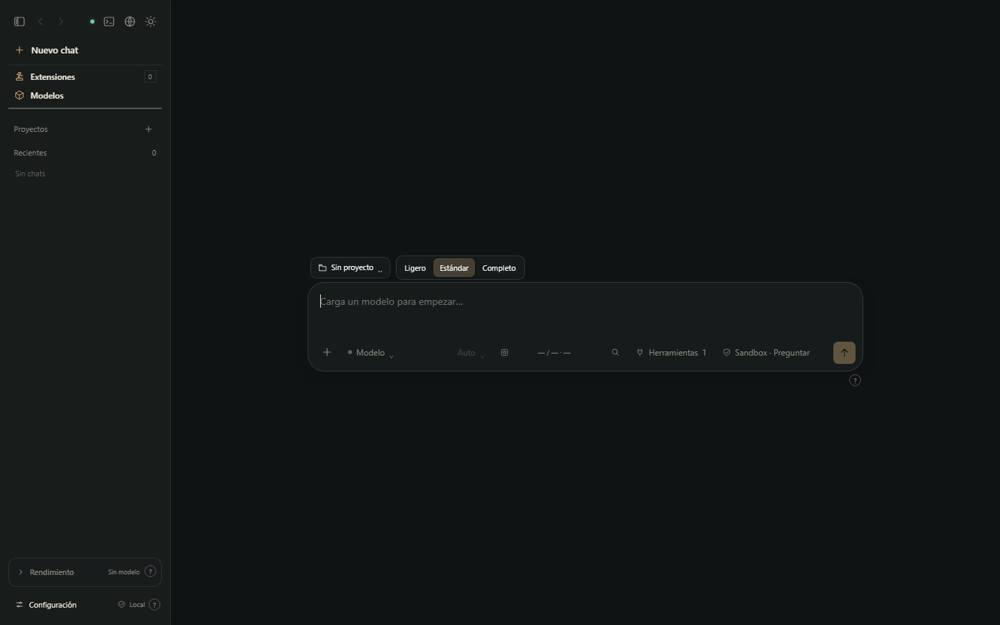

<div align="center">

# V-Agent

**A local-first AI agent for Windows.**
Run GGUF models on your own PC with four local engines (or your own custom builds), or connect an
OpenAI / Claude / Azure / OpenRouter API, with built-in web search, document reading, browser tools and
clear per-action permissions.

<br>

<a href="https://github.com/IsValorum/V-Agent/releases/latest"></a>

<sub>Windows 10/11 · x64 · free and open source · no account, no telemetry</sub>

<br><br>

[](https://github.com/IsValorum/V-Agent/actions/workflows/tests.yml) [](https://github.com/IsValorum/V-Agent/releases/latest) [](LICENSE)

[Architecture](docs/ARCHITECTURE.md) · [Quality](docs/QUALITY.md) · [Local API](docs/local-api.md) · [Changelog](CHANGELOG.md)



</div>

<a href="https://ko-fi.com/isvalorum"></a>

> [!IMPORTANT]
> **Built and tested independently, funded 100% out-of-pocket.**
>
> V-Agent has no ads, no accounts and no telemetry. If it helps you in your day-to-day work, consider
> [supporting it on Ko-fi](https://ko-fi.com/isvalorum). Every contribution goes into the hardware and
> compute time used to test new models, engines and releases, and helps support my university studies.

## Install

1. Download `V-Agent_<version>_x64-setup.exe` from the [latest release](https://github.com/IsValorum/V-Agent/releases/latest).
2. Run it. No administrator rights are needed; by default V-Agent installs in `%LOCALAPPDATA%\Programs\V-Agent`
   and keeps your chats, settings, engines and models in `%LOCALAPPDATA%\V-Agent-Data`.
3. Pick one of the 14 languages and follow the optional tour to choose an engine (or connect an API) and add a model.

> [!NOTE]
> **"Windows protected your PC".** The installer is not signed with a paid Microsoft certificate yet, so
> SmartScreen warns about new downloads. Click **More info → Run anyway** only for installers from this
> repository's [Releases](https://github.com/IsValorum/V-Agent/releases/latest). To check a download first,
> run `Get-FileHash .\V-Agent_<version>_x64-setup.exe` in PowerShell and compare it with the `sha256` in
> `v-agent-update.json` on the same release.

V-Agent tells you when a new version is out: the notice shows its notes, downloads it when you choose and
installs it with **Install and restart**. Every installer and minor update is verified against the
maintainer's Ed25519 signature before it runs.

## Local engines, custom builds and remote APIs

| Engine | What V-Agent does with it |
|---|---|
| **Strata · PolyStrata** | Server for Mixture-of-Experts and dense GGUF models. Sizes the GPU expert cache before every turn and supports MTP speculative decoding, vision and quantized KV caches. |
| **Strata Rust** | Native Rust GPU engine for MoE models (Qwen, Gemma 4, DeepSeek, GLM, Inkling and more; each release adds families), with a private per-session key. |
| **llama.cpp** | Official CUDA, Vulkan (AMD, Intel Arc, NVIDIA) or CPU builds chosen for your hardware, with automatic layer and context fitting, draft models and `mmproj` vision. |
| **Project Maya** *(optional)* | Local integration for `mw00/project-maya` model families, with prerequisite checks and a per-family settings panel. Never forced. |
| **Remote APIs** | OpenAI-compatible, Anthropic Claude, Azure OpenAI, OpenRouter and OpenCode endpoints, with per-connection authentication and custom headers. |

- **Settings read from each engine:** KV cache formats and engine options come from the installed executable, so
  what an engine update adds appears without waiting for a V-Agent update.
- **Any model's tool calls:** Qwen, Inkling 2, Mistral, Llama 3/4, Kimi K2, MiniMax, GPT-OSS, GLM, Gemma 4,
  DeepSeek and LFM2 formats are read while they stream.
- **Your own builds:** every local engine can point to a pre-compiled executable of yours; official builds can
  be installed, updated or removed from *Settings → System and engines*.
- **Memory you can see:** weights, KV cache and reclaimable VRAM are estimated before loading, and generation
  and prompt-reading speeds are measured live.

## Agent modes and tools

| Mode | What the agent can use |
|---|---|
| **Chat** | Conversation with optional web search and page reading (the globe button). No files, commands or other tools. |
| **Light** | Essential file, document, web and command tools; commands ask for approval. |
| **Standard** | Files, web, console, HTTP and Hugging Face tools you enable. |
| **Full** | Also desktop automation and an elevated administrator helper, when you turn them on. |

Access (an isolated folder per chat or project, or the whole PC) and approvals (*Ask*, *Confirm changes*,
*Automatic*) are chosen separately and enforced by the core, not only by the interface.

| MCP server | Capabilities |
|---|---|
| **`duckduckgo`** — WebSearch / WebVisit | Live web search and a page reader that also extracts PDF, Office, OpenDocument, EPUB and RTF documents. |
| **`pc`** — files, documents, commands | Reading, writing and editing files with version history, project maps, draft recovery, document reading with OCR, and sandboxed or full-PC commands with a shared console. |
| **`autobrowser`** | A headless browser the agent drives, plus the visible browser you share with it. |
| **`web`** | Structured HTTP requests and verified downloads. |
| **`computer`** | Opt-in screen capture, OCR, windows, mouse and keyboard. |
| **`admin`** | Opt-in single-session elevated helper for administrator commands. |
| **`hf`** | Hugging Face account, CLI and transfers. |

Your own MCP servers and local plugins can be added in *Tools* and *Extensions*.

## Interface

- **Models window:** browse Hugging Face with GPU/RAM fit per quant and download with SHA-256 verification.
  *Models on this PC* finds the GGUF files you already have (LM Studio, Unsloth Studio, the Hugging Face cache
  and any folder you add), shows each in its real folder and imports a whole list in seconds, with its settings;
  settings can also be exported back to LM Studio and Unsloth Studio.
- **Conversations:** temporary chats (never saved unless you choose **Save chat**), pinned chats, date groups, projects, a collapsible tool timeline,
  context compaction and persistent instructions (`AGENTS.md`).
- **Productivity:** command palette (`Ctrl+K`), find in conversation (`Ctrl+F`), prompt library, keyboard
  shortcuts (`Ctrl+/`) and local usage statistics computed only from your own history.
- **Code checks:** syntax and static checks for many languages, and HTML pages run in a headless preview.
- **14 languages:** English, Español, Português, Français, Deutsch, 日本語, 简体中文, 한국어, हिन्दी,
  Bahasa Indonesia, Tiếng Việt, ไทย, Türkçe and العربية (right-to-left), with themes, palettes and logos.


## Repository map

| Folder | What lives there |
|---|---|
| [`agent/`](agent/) | The core: agent loop, local API, engines, bundled MCP servers, updates, and the interface source in [`agent/ui/`](agent/ui/). |
| [`serve/`](serve/) | OpenAI/Anthropic-compatible request layer and MCP hub (from PolyStrata). |
| [`web_mcp/`](web_mcp/) | WebSearch/WebVisit and the HTTP/download tools. |
| [`tools/`](tools/) | GGUF metadata reader and tokenizer used when importing models. |
| [`desktop/`](desktop/) | The Windows desktop app (Tauri 2, Rust) and its installer. |
| [`scripts/`](scripts/) | Interface build, clean release build, release signing and quality tools. |
| [`tests/`](tests/) | Automated Python and Node tests, and smoke harnesses. |
| [`docs/`](docs/) | Architecture, local API reference, quality process and the in-app user guide. |

`backend.py` is the entry point of the packaged core (`core\v-agent-core.exe`): it runs the local server and,
with `--role`, each bundled MCP worker.

## Build and test

Requirements: Windows 10/11 x64, Python 3.13, Node.js 20+, Rust (stable MSVC) and Visual Studio Build Tools.

```bat
python -m venv .venv
.venv\Scripts\pip install -r requirements.txt

:: build the interface (checks every translation) and run the automated tests
.venv\Scripts\python scripts\build-ui.py
.venv\Scripts\python -m unittest discover -s tests
for %f in (tests\*.cjs) do node %f

:: run the core from source with a throw-away data folder (http://127.0.0.1:19381)
.venv\Scripts\python backend.py --port 19381 --data-dir %TEMP%\v-agent-dev -- --background

:: developer desktop build, or the clean verified installer
scripts\build-desktop.cmd
scripts\build-release.cmd
```

See [RELEASING.md](RELEASING.md) for signing and publishing (maintainer only).

## Security and privacy

- Every service listens on `127.0.0.1` only and checks local origins; engines use a per-session secret key.
- GGUF model files are never modified; they are moved into V-Agent's models folder only when you choose to.
- Commands run in a Windows process sandbox in isolated and project scopes; full-PC access is opt-in.
- Write, command and network actions are approved inside the core, not only in the interface.
- The agent's own browser cannot open V-Agent's interface or API, so it cannot change access or settings.
- Installers and minor updates are verified against the maintainer's Ed25519 key; engine and Hugging Face
  downloads by their official origin and SHA-256 digests.

Read [SECURITY.md](SECURITY.md) to report a vulnerability and [PRIVACY.md](PRIVACY.md) for what is stored locally.

## Contributing

Issues and pull requests are welcome: see [CONTRIBUTING.md](CONTRIBUTING.md) and
[docs/ARCHITECTURE.md](docs/ARCHITECTURE.md).

## License

[Apache License 2.0](LICENSE). Bundled and vendored components keep their own licenses: see [NOTICE](NOTICE),
[LICENSE.Strata](LICENSE.Strata) (MIT, PolyStrata/Strata code in `serve/` and `tools/`) and
[THIRD-PARTY-NOTICES.md](THIRD-PARTY-NOTICES.md).
