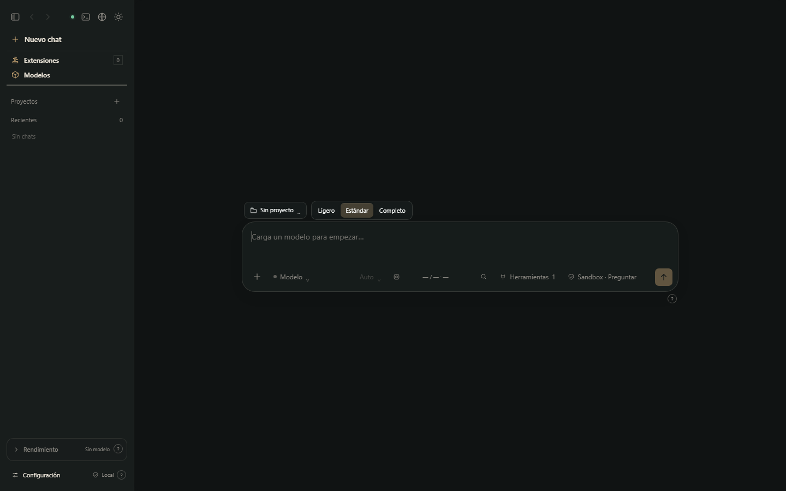
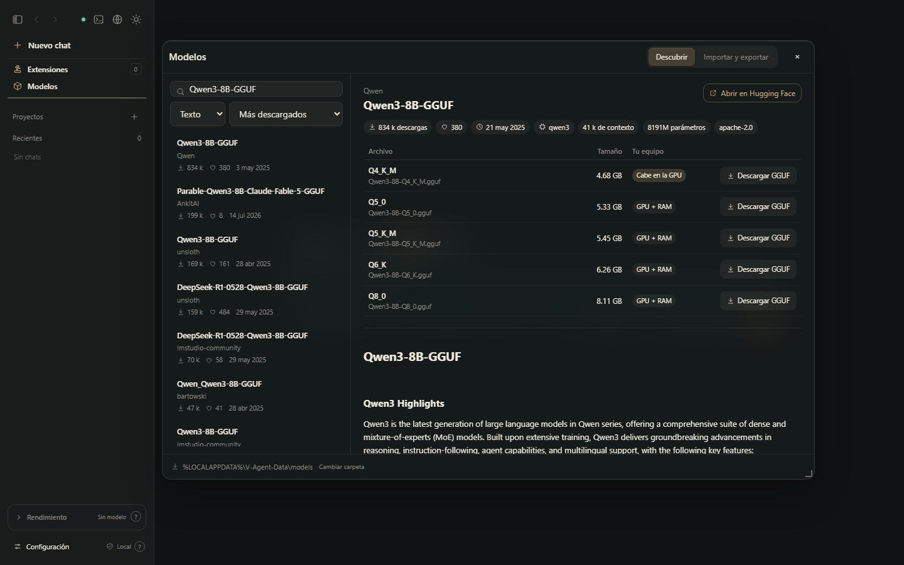

<div align="center">

# V-Agent

**A local-first AI agent for Windows.**
Run GGUF models on your own PC — or connect an OpenAI/Claude-compatible API — and give them real
tools with clear permissions.

[Download](../../releases/latest) · [Architecture](docs/ARCHITECTURE.md) · [Changelog](CHANGELOG.md) · [Leer en español](README.es.md)



</div>

## What it does

- **Runs models locally** with the official **llama.cpp** builds (CUDA, Vulkan or CPU, picked for your
  hardware and downloaded from their GitHub releases), **Strata** or **Strata Rust**. Remote
  OpenAI- and Claude-compatible APIs work too.
- **Gives the model tools** — files (with versions and undo), commands, web search and page reading,
  an autonomous browser, HTTP requests, Hugging Face and any MCP server — inside an **isolated folder
  per chat** or on the whole PC, with per-action approvals.
- **Finds models for you** — the *Models* window browses Hugging Face (downloads, likes, context,
  license, rendered model card, and whether each quant fits your GPU), downloads with SHA-256
  verification, and imports models and their settings from **LM Studio** and **Unsloth Studio**.
- **Checks code it writes** — syntax for Python, JavaScript, JSON, YAML, TOML, XML/SVG and Java;
  HTML pages are run in a headless browser and report runtime errors.
- **Stays yours** — no account, no telemetry. Updates are signed; the app only accepts what the
  maintainer signed.



## Install

1. Download `V-Agent_<version>_x64-setup.exe` from [Releases](../../releases/latest) (Windows 10/11, x64).
2. Pick your language (Español, English, Português, Français, Deutsch) and the folder. No admin rights needed.
3. On first start V-Agent recommends an engine for your hardware and installs it after you confirm.
4. Add a GGUF model or open **Models** to find one, and start chatting. A short tour explains the rest.

V-Agent keeps itself current: shortly after it starts it applies the newest signed **minor update**
(numbered *1.0.0 C1, C2…*, no installer) and downloads a newer installer if one exists, which it
installs only when you say so.

## Repository map

| Folder | What lives there |
|---|---|
| [`agent/`](agent/) | The core: chat/agent loop, local API, engines, tools (MCP servers), updates, and the interface (`index.html` + `ui-*.js`). |
| [`serve/`](serve/) | OpenAI/Anthropic-compatible request layer and MCP hub, vendored from PolyStrata. |
| [`web_mcp/`](web_mcp/) | Web search, page reading and HTTP tools (MCP servers). |
| [`tools/`](tools/) | GGUF header reader and tokenizer used when importing models. |
| [`desktop/`](desktop/) | The Windows app (Tauri 2, Rust) and its installer configuration. |
| [`scripts/`](scripts/) | Build, packaging, interface sync and release signing. |
| [`tests/`](tests/) | Automatic tests (Python + interface) and manual smoke tests. |
| [`docs/`](docs/) | Architecture, local API, user guide, screenshots and design notes. |

`backend.py` is the single entry point of the packaged core (`strata-core.exe`): it serves the API
and, with `--role`, runs each bundled MCP server.

## Build and test

Requirements: Windows 10/11 x64, Python 3.13, Node.js 20+, Rust (stable, MSVC) and Visual Studio
Build Tools.

```bat
python -m venv .venv
.venv\Scripts\pip install -r requirements.txt

:: run the automatic tests
.venv\Scripts\python -m unittest discover -s tests
for %f in (tests\*.cjs) do node %f

:: run the core from source with a throw-away data folder, then open http://127.0.0.1:19381
.venv\Scripts\python backend.py --port 19381 --data-dir %TEMP%\v-agent-dev -- --background

:: builds
scripts\build-desktop.cmd      :: developer build of the desktop app
scripts\build-release.cmd      :: official installer (no engines, no personal data)
```

Set `V_AGENT_RUST_BIN` if `cargo` is not on your `PATH`. [RELEASING.md](RELEASING.md) explains signing
and publishing (maintainer only).

## Security and privacy

- Everything listens on `127.0.0.1` only. Model files are never copied or modified.
- Commands run in a Windows process container in sandbox mode; whole-PC access is opt-in.
- Updates (installers, minor updates and engines) are verified before use: Ed25519 signature from the
  maintainer for V-Agent, official GitHub release and SHA-256 for engines and Hugging Face downloads.

Read [SECURITY.md](SECURITY.md) to report a vulnerability and [PRIVACY.md](PRIVACY.md) for what is
stored where.

## Contributing

Issues and pull requests are welcome — see [CONTRIBUTING.md](CONTRIBUTING.md). Start with
[docs/ARCHITECTURE.md](docs/ARCHITECTURE.md) for a tour of the code.

## License

[Apache License 2.0](LICENSE). Bundled and vendored components keep their own licenses: see
[NOTICE](NOTICE), [LICENSE.Strata](LICENSE.Strata) (MIT, PolyStrata/Strata code in `serve/` and
`tools/`) and [THIRD-PARTY-NOTICES.md](THIRD-PARTY-NOTICES.md).
