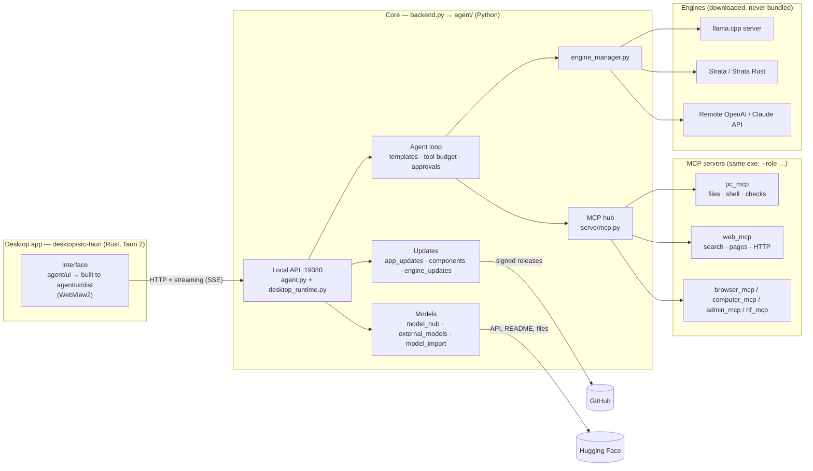

# V-Agent architecture

A tour of the code for reviewers and contributors. V-Agent is two programs talking over HTTP on
`127.0.0.1`: a small **desktop shell** (Rust/Tauri) that draws the window, and a **core** (Python,
packaged as `strata-core.exe`) that does everything else.

## How a message travels

1. The interface posts the conversation to `POST /api/chat` and reads the answer as a stream.
2. `agent/agent.py` builds the prompt with the model's own chat template (`templates.py`,
   `thinking_policy.py`), trims tool descriptions to fit (`tool_budget.py`, `mcp_prompt.py`) and keeps
   long history within the context window (`context_policy.py`).
3. `engine_manager.py` sends it to the active engine (local llama.cpp/Strata process or a remote API;
   `remote_protocols.py` translates wire formats).
4. When the model calls a tool, `tool_markup.py` recovers the call, `tool_approvals.py` decides whether
   to ask the user, and the call goes to an MCP server through the hub (`serve/mcp.py`,
   `stdio_worker.py`). File writes are confined by `access_policy.py`; sandboxed commands run in a
   Windows process container (`sandbox_exec.py`).
5. Results go back to the model until it answers; drafts of interrupted writes are kept
   (`draft_store.py`, `draft_recovery.py`) and every file change is versioned (`file_versions.py`).

## The core (`agent/`)

| Area | Modules |
|---|---|
| Entry and API | `backend.py` (process roles), `agent.py` (agent loop + HTTP API), `desktop_runtime.py` (engine-neutral routes: engines, updates, models, preferences) |
| Engines | `engine_manager.py`, `engine_updates.py` (official prebuilt releases), `engine_recommendations.py`, `hardware_stats.py`, `memory_estimate.py`, `kv_settings.py`, `load_settings.py`, `draft_*.py`, `vram_policy.py` |
| Models | `model_import.py`, `model_preferences.py`, `model_preparation.py`, `gguf_catalog.py`, `templates.py`, `model_hub.py` (Hugging Face), `external_models.py` (LM Studio / Unsloth Studio) |
| Tools (MCP servers) | `pc_mcp.py`, `browser_mcp.py`, `computer_mcp.py`, `admin_mcp.py`, `hf_mcp.py`, plus `web_mcp/` |
| Safety | `access_policy.py`, `sandbox_exec.py`, `tool_approvals.py`, `agent_profiles.py`, `output_paths.py` |
| Code checks | `verify.py` (syntax), `render_check.py` + `scene_probe.js` (headless browser), `diagnostics.py` |
| Storage | `runtime_paths.py` (where data lives), `local_store.py` (chats), `projects.py`, `ui_preferences.py`, `app_preferences.py`, `mcp_options.py`, `plugins.py`, `extensions.py` |
| Updates | `app_updates.py` (signed installers), `components.py` (signed minor updates), `engine_updates.py` |

## The interface

Tauri 2 draws the window with WebView2, so the interface is a web page. Its source is in
[`agent/ui/`](../agent/ui/): `v-agent.html` (the page skeleton), `styles/`, `standalone/` scripts and
`app/` — the program split by topic into 21 files (chat, conversations, settings, models, tour…).
`scripts/build-ui.py` assembles them into `agent/ui/dist/v-agent.html`, which the core serves and the
desktop app embeds (`tauri.conf.json` → `frontendDist`). The parts share one scope, so their order
in `v-agent.html` matters; [agent/ui/README.md](../agent/ui/README.md) lists what each one does.

Colours always come from palette tokens (`--accent`, `--panel`, `--text`, `--muted`, `--border`…) so
the eight palettes and the glass, soft and Art Deco styles all apply. Text shown to people goes
through `uiText()` and is translated in `agent/ui/locales.json` (es, en, pt, fr, de).

## Updates and trust

| Channel | What | How it is trusted |
|---|---|---|
| App | New installer (`v<version>` release) | Manifest signed with the maintainer's Ed25519 key (public key in `app_updates.py`), higher version, size and SHA-256 match |
| Minor ("1.0.0 C1, C2…") | `components-<version>-r<N>` release: listed MCP/tool modules and `ui-patch.css`/`ui-patch.js` | Same signature, exact app version, file allow-list, hashes re-checked at every start |
| Engines | llama.cpp / Strata official releases | Official repository only, published SHA-256, test run before activation, rollback |
| Models | Hugging Face downloads | SHA-256 published by the Hub; the user's token is never sent to other hosts |

The core applies the newest minor update and downloads newer installers a few seconds after it starts
(`desktop_runtime.automatic_updates`); installing a full update always asks first.

## Where data lives

`runtime_paths.py` decides it: the installed app keeps everything in `%LOCALAPPDATA%\V-Agent-Data`
(chats, settings, engines, logs, minor updates, downloaded models). Running from source uses
`--data-dir` or `./data`. Model files elsewhere are only referenced, never copied.

## Vendored code

- `serve/` — the OpenAI/Anthropic-compatible request layer and MCP hub from PolyStrata (MIT, see
  `LICENSE.Strata`). V-Agent uses `serve/mcp.py`, `serve/frontend.py` and `serve/models.py`; the rest is
  the engine server started with `--role strata-server`.
- `tools/gguf_reader.py`, `tools/strata_tokenizer.py` — GGUF header reader and tokenizer (same origin).

More reading: [local-api.md](local-api.md) (API notes), [VAL-Agent-Guide.html](VAL-Agent-Guide.html)
(user guide shown in the app) and [notes/](notes/) (design notes and reviews).
