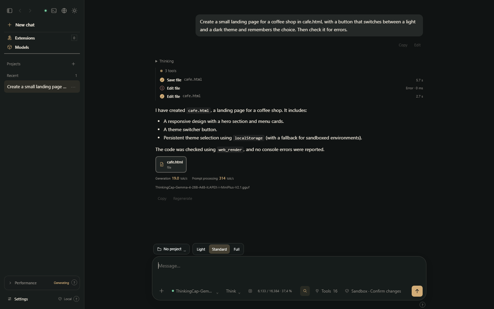
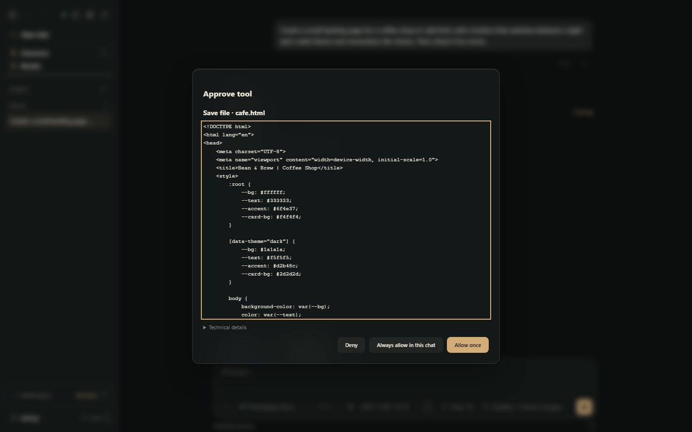
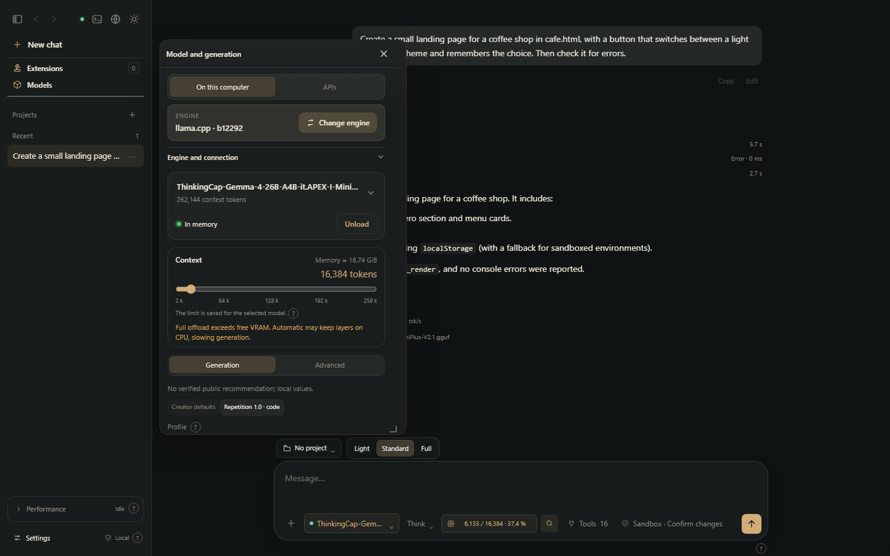
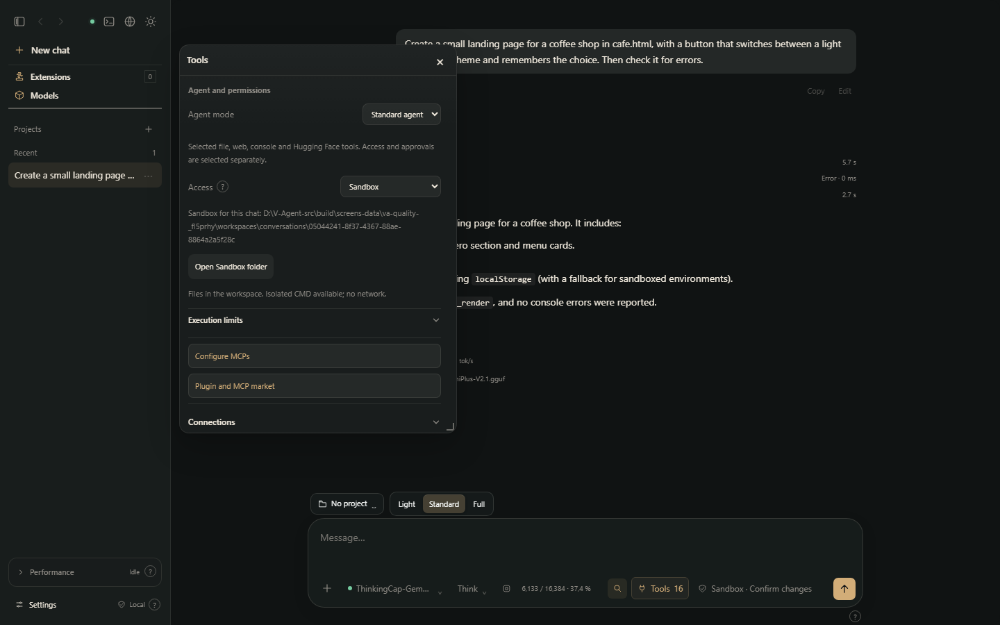
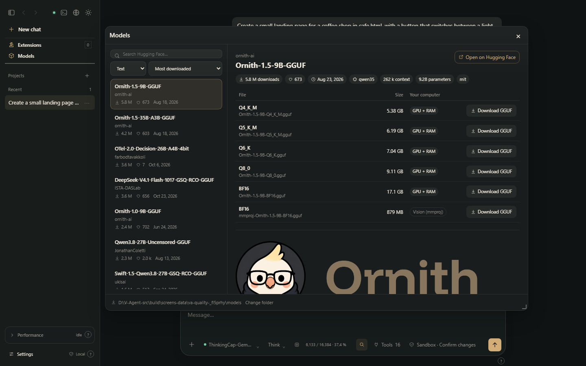
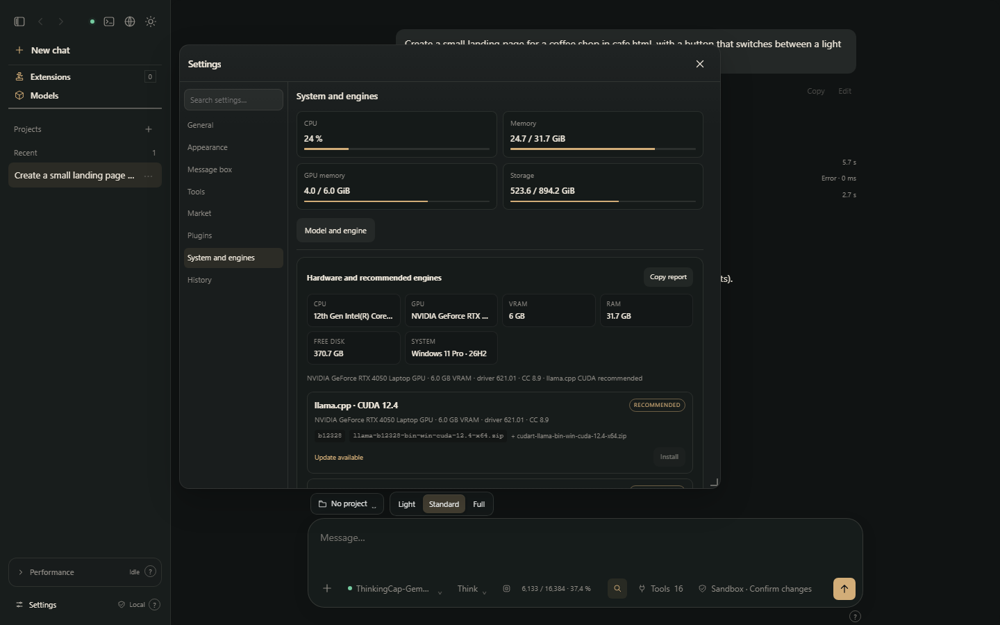
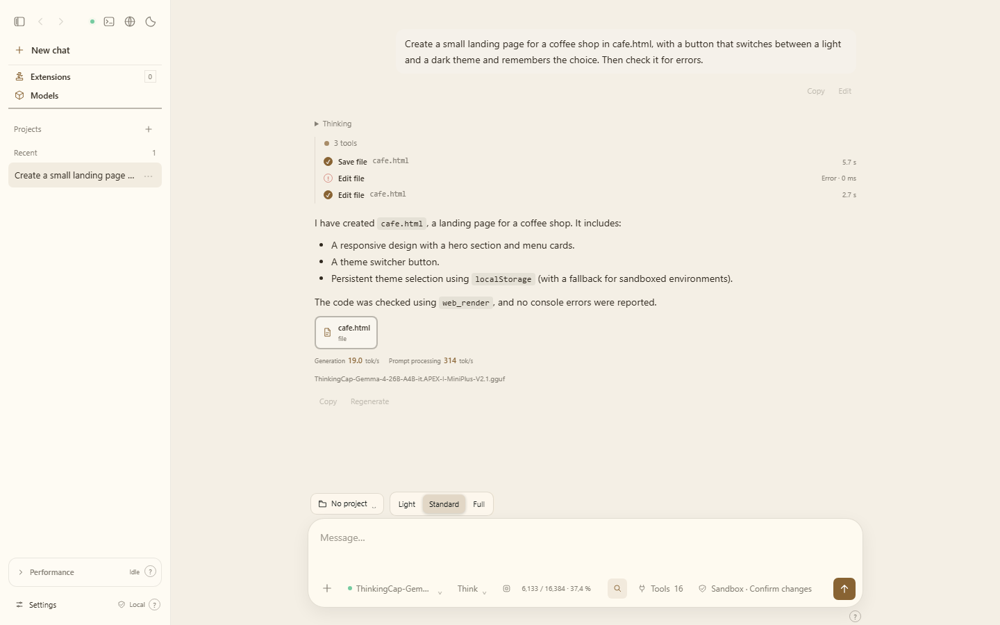

# V-Agent 1.0.7 — test results

Run on 2026-11-12 with `scripts/quality/run_all.py`, from the source of this version (including any fixes listed as "Unreleased" in the [changelog](../../CHANGELOG.md)), in 18 minutes. Every check below was executed for this report; none is copied from an earlier run.

**143 passed · 0 failed · 0 skipped**

| | |
|---|---|
| System | Windows 11 (10.0.26300), Python 3.13.15 |
| GPU | NVIDIA GeForce RTX 4050 Laptop GPU, 6141 MiB |
| Engines | llama.cpp (CUDA), Strata and Strata Rust, as installed by V-Agent |
| Models | Real GGUF models; Mixture-of-Experts models of up to 35B parameters on Strata and Strata Rust |

## 1. Automatic tests

| | Check | Where | Detail |
|---|---|---|---|
| ✅ | interface assembles from source | build | Interface built in agent/ui/dist (1248 translated phrases). |
| ✅ | Python test suite (214 tests) | core | OK |
| ✅ | Node interface suites (7) | interface | test_palette, test_permission_ui, test_response_metrics, test_ui_i18n, test_ui_motion, test_ui_rich_stream, test_update_notice |

## 2. Static analysis

| | Check | Where | Detail |
|---|---|---|---|
| ✅ | ruff (ruff 0.17.4) on all Python | static analysis | 0 findings |
| ✅ | bandit (medium and high) on the core: 28 findings, all reviewed | static analysis | 17 reviewed groups in bandit-reviewed.json |
| ✅ | ESLint rules fire on deliberate faults | static analysis | reported ['no-cond-assign', 'no-constant-condition', 'no-func-assign', 'no-undef', 'valid-typeof'] |
| ✅ | ESLint (v9.39.1) on the assembled interface (3 inline scripts + assets) | static analysis | 0 errors |
| ✅ | no stray control characters in 258 text files | static analysis |  |

## 3. Code checker

| | Check | Where | Detail |
|---|---|---|---|
| ✅ | ok.py passes | code checker | ok=True |
| ✅ | return_outside.py is reported | code checker | 'return' outside function (return_outside.py, line 2) |
| ✅ | await_outside.py is reported | code checker | 'await' outside function (await_outside.py, line 3) |
| ✅ | ok.json passes | code checker | ok=True |
| ✅ | bad.json is reported | code checker | Expecting ',' delimiter: line 1 column 12 (char 11) |
| ✅ | ok.toml passes | code checker | ok=True |
| ✅ | bad.toml is reported | code checker | Illegal character '\n' (at line 1, column 11) |
| ✅ | ok.xml passes | code checker | ok=True |
| ✅ | bad.xml is reported | code checker | mismatched tag: line 1, column 9 |
| ✅ | entity.xml is reported | code checker | DTD/entity declarations are not supported by this check. |
| ✅ | ok.svg passes | code checker | ok=True |
| ✅ | bad.svg is reported | code checker | mismatched tag: line 1, column 56 |
| ✅ | ok.css passes | code checker | ok=True |
| ✅ | unclosed_block.css is reported | code checker | line 1: '{' is never closed |
| ✅ | unclosed_comment.css is reported | code checker | line 1: comment /* is never closed |
| ✅ | ok.ps1 passes | code checker | ok=True |
| ✅ | bad.ps1 is reported | code checker | line 1: Falta la llave de cierre "}" en el bloque de instrucciones o la definición de tipo. |
| ✅ | ok.js (Node.js) passes | code checker | ok=True |
| ✅ | bad.js (Node.js) is reported | code checker | code:1 const a = ;           ^ SyntaxError: Unexpected token ';' |
| ✅ | ok.mjs (Node.js) passes | code checker | ok=True |
| ✅ | bad.mjs (Node.js) is reported | code checker | code:3 const y = x +;              ^ SyntaxError: Unexpected token ';' |
| ✅ | ok.cjs (Node.js) passes | code checker | ok=True |
| ✅ | bad.cjs (Node.js) is reported | code checker | code:1 module.exports = {;                   ^ SyntaxError: Unexpected token ';' |
| ✅ | ok.html (Node.js) passes | code checker | ok=True |
| ✅ | bad.html (Node.js) is reported | code checker | Script 1: code:1 let a=;       ^ SyntaxError: Unexpected token ';' |
| ✅ | ok.js (bundled browser, no Node.js) passes | code checker | ok=True |
| ✅ | bad.js (bundled browser, no Node.js) is reported | code checker | line 1: SyntaxError: Unexpected token ';' |
| ✅ | ok.mjs (bundled browser, no Node.js) passes | code checker | ok=True |
| ✅ | bad.mjs (bundled browser, no Node.js) is reported | code checker | line 3: SyntaxError: Unexpected token ';' |
| ✅ | ok.cjs (bundled browser, no Node.js) passes | code checker | ok=True |
| ✅ | bad.cjs (bundled browser, no Node.js) is reported | code checker | line 1: SyntaxError: Unexpected token ';' |
| ✅ | ok.html (bundled browser, no Node.js) passes | code checker | ok=True |
| ✅ | bad.html (bundled browser, no Node.js) is reported | code checker | Script 1: line 1: SyntaxError: Unexpected token ';' |
| ✅ | bad.c: without gcc/clang it says "not checked", not "fine" | code checker | Not checked: install clang, gcc to check .c files. |
| ✅ | bad.cpp: without g++/clang++ it says "not checked", not "fine" | code checker | Not checked: install clang++, g++ to check .cpp files. |
| ✅ | bad.rs: reported by rustc | code checker | error: expected expression, found `;`  --> bad.rs:1:21   \| 1 \| fn main() { let x = ; }   \|                     ^ expecte |
| ✅ | bad.go: without gofmt it says "not checked", not "fine" | code checker | Not checked: install gofmt to check .go files. |
| ✅ | bad.ts: without tsc it says "not checked", not "fine" | code checker | Not checked: install tsc to check .ts files. |
| ✅ | bad.php: without php it says "not checked", not "fine" | code checker | Not checked: install php to check .php files. |
| ✅ | bad.rb: without ruby it says "not checked", not "fine" | code checker | Not checked: install ruby to check .rb files. |
| ✅ | bad.lua: without luac it says "not checked", not "fine" | code checker | Not checked: install luac, luac5.4 to check .lua files. |
| ✅ | bad.sh: reported by sh | code checker | bad.sh: line 2: syntax error: unexpected end of file from `if' command on line 1 |
| ✅ | bad.java: reported by javac | code checker | \bad.java:1: error: illegal start of expression public class A { public static void main(String[] a){ int x = ; } }      |
| ✅ | theme.html is reported: it fails in the sandboxed preview | code checker | ["pagina:6: SecurityError: Failed to read the 'localStorage' property from 'Window': The document is sandboxed and lacks |
| ✅ | theme_guarded.html opens cleanly in the sandboxed preview | code checker | [] |

## 4. Untrusted content

| | Check | Where | Detail |
|---|---|---|---|
| ✅ | 28 XSS vectors in a model card: none ran | interface | none ran |
| ✅ | no dangerous element survives in the card | interface | none |
| ✅ | no event handler, style or srcdoc attribute survives | interface | none |
| ✅ | every surviving link or image points to https | interface | all https |
| ✅ | each closed vector is parsed in place (none swallows the next) | interface | 25 of 25 markers rendered |
| ✅ | the normal content of the card still renders | interface | bold text and https link present |

## 5. Interface

| | Check | Where | Detail |
|---|---|---|---|
| ✅ | start: neither the screen nor the core has a model loaded | interface | {'state': 'idle', 'button': '‹model›.gguf ⌄'} |
| ✅ | load: the screen says loaded and the core has that model | interface | screen {'state': 'loaded', 'name': '‹model›.gguf', 'context': '8192 tokens'} · core llama--local-d76faa589c27b3a0 |
| ✅ | load: the context on screen is the engine's | interface | core 8192 |
| ✅ | context change reaches the engine | interface | core 10240 · screen {'state': 'loaded', 'context': '10.240 tokens'} |
| ✅ | a context set outside the window is shown as the engine has it | interface | core 12288 · screen 12.288 tokens |
| ✅ | a request from the composer writes the file on disk | interface | 'hola desde la interfaz' |
| ✅ | stop: the screen and the engine both stop | interface | screen {'during': True, 'after': False, 'label': 'Enviar mensaje'} · engine idle |
| ✅ | reload: the loaded model is still shown as loaded | interface | {'state': 'loaded', 'name': '‹model›.gguf', 'max': '777'} |
| ✅ | reload: the response limit is kept | interface | 777 |
| ✅ | unload: the screen and the core agree | interface | {'state': 'idle'} |
| ✅ | engine switch reaches the core | interface | screen rust · core rust |
| ✅ | engine switch back reaches the core | interface |  |
| ✅ | language change survives a reload | interface | en |
| ✅ | deleting a chat removes it on screen and in the core | interface | screen {'before': 1, 'after': 0, 'menu': True, 'confirmed': True} · core 1→0 |
| ✅ | reload: the chat list matches the core | interface | screen 0 · core 0 |
| ✅ | no status message was written where nobody can see it | interface | none |
| ✅ | no page errors during the run | interface | none |
| ✅ | the context meter moves on screen while the model thinks and uses tools | interface | changes: 5; longest stretch without a change: 0.9 s; went down: False; page errors: none |
| ✅ | walk through every window and settings page at 1280x800, dark theme | interface | 19 screenshots, no page errors |
| ✅ | walk through every window and settings page at 1280x800, light theme | interface | 19 screenshots, no page errors |
| ✅ | walk through every window and settings page at 800x600, dark theme | interface | 19 screenshots, no page errors |
| ✅ | repaint probe: no window repaints while idle | interface | Windows repainting while idle: none |

## 6. Real models

| | Check | Where | Detail |
|---|---|---|---|
| ✅ | model loads | llama | context 8192 |
| ✅ | engine server refuses GET /v1/models without its key | llama | HTTP 401 |
| ✅ | engine server refuses POST /v1/chat/completions without its key | llama | HTTP 401 |
| ✅ | the core reads the engine (with its key) | llama | context limit 8192 |
| ✅ | the core refuses a foreign Host header | llama | HTTP 421 |
| ✅ | creates the Python file it was asked for and it compiles | llama | utilities.py; [('pc__fs_write', True), ('pc__code_check', True)] |
| ✅ | creates cafeteria.html | llama | [('pc__fs_write', True)] |
| ✅ | the sandboxed-preview error is caught (page clean, or the checker told the model) | llama | reported to the model, which left it unfixed: ["pagina:6: SecurityError: Failed to read the 'localStorage' property from 'Window': The document is sandboxed and lacks the 'allow-same-ori |
| ✅ | edits a file on request | llama | nota.txt: 'version 2' |
| ✅ | a denied approval leaves the file untouched | llama | 1 approval(s) asked, denied; file 'version 2' |
| ✅ | leaving a reply half way stops the engine | llama | stopped 0.3 s after the client left (state idle) |
| ✅ | the next request works | llama | finished normally |
| ✅ | two chats at once: alfa writes only in its own folder or waits its turn | llama | written in its own folder |
| ✅ | two chats at once: bravo writes only in its own folder or waits its turn | llama | told clearly that another reply is running |
| ✅ | two chats at once: at least one of them finishes | llama |  |
| ✅ | /api/chat with broken JSON gets a 4xx | llama | HTTP 400 |
| ✅ | /api/chat with a list instead of an object gets a 4xx | llama | HTTP 400 |
| ✅ | /api/chat with messages that are not a list gets a 4xx | llama | HTTP 400 |
| ✅ | the core still answers afterwards | llama |  |
| ✅ | unloading closes the engine server | llama |  |
| ✅ | live context count moves during thinking and tool rounds | llama | live samples: True; samples without a value during the reply: 0; longest stretch without a change: 0.3 s over 4 s |
| ✅ | model loads | strata | context 8192 |
| ✅ | the core reads the engine (with its key) | strata | context limit 8192 |
| ✅ | the core refuses a foreign Host header | strata | HTTP 421 |
| ✅ | creates the Python file it was asked for and it compiles | strata | utilidades.py; [('pc__fs_write', True), ('pc__code_check', True), ('pc__fs_read', True)] |
| ✅ | creates cafeteria.html | strata | [('pc__fs_list', True), ('pc__fs_write', True), ('pc__code_check', True), ('pc__fs_edit', True), ('pc__code_check', True)] |
| ✅ | the sandboxed-preview error is caught (page clean, or the checker told the model) | strata | page opens without errors |
| ✅ | edits a file on request | strata | nota.txt: 'version 2' |
| ✅ | a denied approval leaves the file untouched | strata | 1 approval(s) asked, denied; file 'version 2' |
| ✅ | leaving a reply half way stops the engine | strata | stopped 0.3 s after the client left (state idle) |
| ✅ | the next request works | strata | finished normally |
| ✅ | two chats at once: alfa writes only in its own folder or waits its turn | strata | written in its own folder |
| ✅ | two chats at once: bravo writes only in its own folder or waits its turn | strata | told clearly that another reply is running |
| ✅ | two chats at once: at least one of them finishes | strata |  |
| ✅ | /api/chat with broken JSON gets a 4xx | strata | HTTP 400 |
| ✅ | /api/chat with a list instead of an object gets a 4xx | strata | HTTP 400 |
| ✅ | /api/chat with messages that are not a list gets a 4xx | strata | HTTP 400 |
| ✅ | the core still answers afterwards | strata |  |
| ✅ | a model it cannot run is refused with a clear message | strata | 0.3 s: Strata no ejecuta modelos de arquitectura «‹architecture›». Usa llama.cpp para este modelo (Ajustes → Modelo → Motor) o busca una versión de Strata que la admita. |
| ✅ | live context count moves during thinking and tool rounds | strata | live samples: True; samples without a value during the reply: 0; longest stretch without a change: 1.3 s over 19 s |
| ✅ | model loads | rust | context 8192 |
| ✅ | engine server refuses GET /v1/models without its key | rust | HTTP 401 |
| ✅ | engine server refuses POST /v1/chat/completions without its key | rust | HTTP 401 |
| ✅ | the core reads the engine (with its key) | rust | context limit 8192 |
| ✅ | the core refuses a foreign Host header | rust | HTTP 421 |
| ✅ | creates the Python file it was asked for and it compiles | rust | utilidades.py; [('pc__fs_write', True), ('pc__code_check', True)] |
| ✅ | creates cafeteria.html | rust | [('mcp__invalid_call', False), ('pc__fs_write', True), ('pc__fs_edit', True)] |
| ✅ | the sandboxed-preview error is caught (page clean, or the checker told the model) | rust | page opens without errors |
| ✅ | edits a file on request | rust | nota.txt: 'version 2' |
| ✅ | a denied approval leaves the file untouched | rust | 1 approval(s) asked, denied; file 'version 2' |
| ✅ | leaving a reply half way stops the engine | rust | stopped 0.3 s after the client left (state idle) |
| ✅ | the next request works | rust | finished normally |
| ✅ | two chats at once: alfa writes only in its own folder or waits its turn | rust | written in its own folder |
| ✅ | two chats at once: bravo writes only in its own folder or waits its turn | rust | told clearly that another reply is running |
| ✅ | two chats at once: at least one of them finishes | rust |  |
| ✅ | /api/chat with broken JSON gets a 4xx | rust | HTTP 400 |
| ✅ | /api/chat with a list instead of an object gets a 4xx | rust | HTTP 400 |
| ✅ | /api/chat with messages that are not a list gets a 4xx | rust | HTTP 400 |
| ✅ | the core still answers afterwards | rust |  |
| ✅ | unloading closes the engine server | rust |  |
| ✅ | a model it cannot run is refused with a clear message | rust | 2.4 s: Strata Rust no ejecuta modelos de arquitectura «‹architecture›» (admite: qwen3, qwen3moe, qwen3next, qwen35, qwen35moe, qwen4exp). Usa llama.cpp para este modelo. |
| ✅ | live context count moves during thinking and tool rounds | rust | live samples: True; samples without a value during the reply: 0; longest stretch without a change: 6.3 s over 23 s |

## 7. Published release

_Not run this time._

## The interface of this version

Taken with `scripts/quality/screenshots.py` from this version's interface, with a model loaded on llama.cpp and a real request (nothing staged or edited).

**A real agent run: the model writes a page, checks it, fixes what the sandboxed preview rejects**

**The write waits for approval ("Confirm changes" mode)**

**Model window: engine, loaded model and the context the engine really runs with**

**Tools: agent mode, per-chat sandbox and approvals**

**Hugging Face browser: files, sizes and whether each quant fits this PC**

**System and engines: hardware detected and the recommended engine build**

**The same conversation in the light theme**

## How to reproduce

Each level is a script in this repository; [docs/QUALITY.md](../QUALITY.md) explains them and [tests/README.md](../../tests/README.md) lists their options. "Skipped" means the check could not be made on this machine or in this run (for example the model did not try the action); it is never counted as passed.
